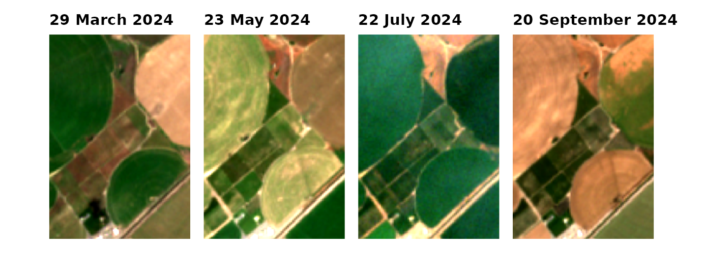
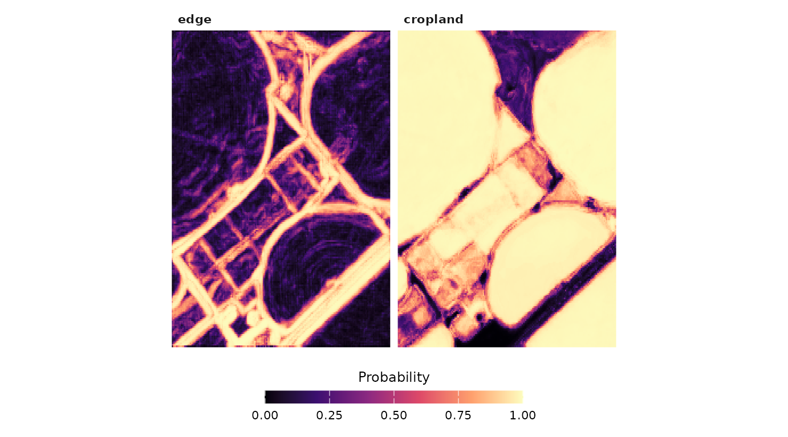
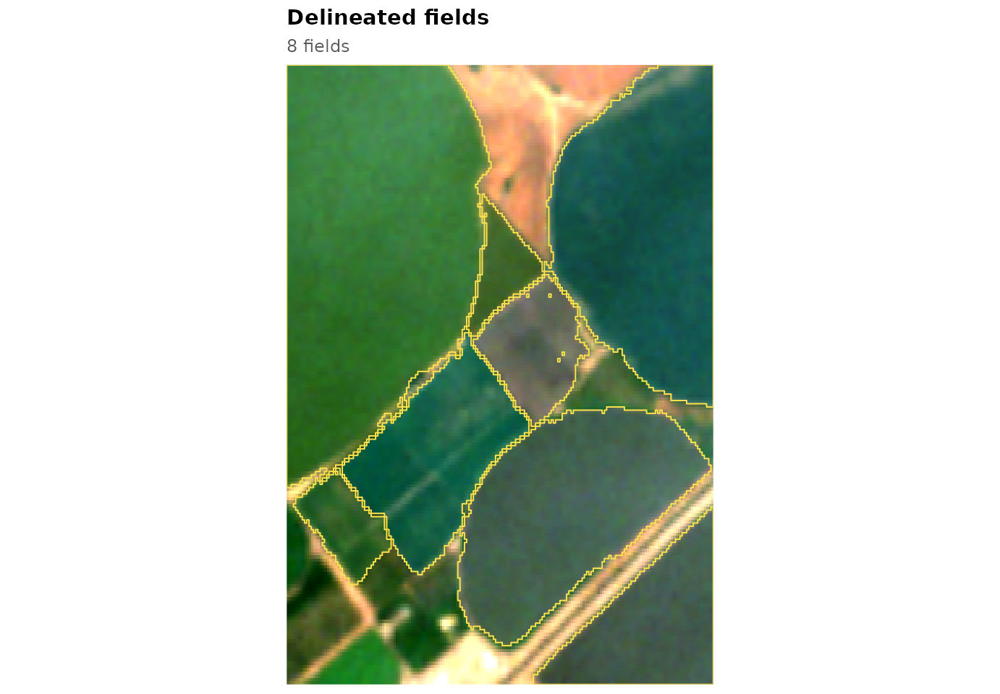
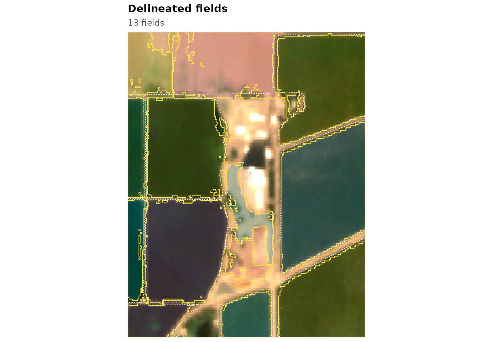
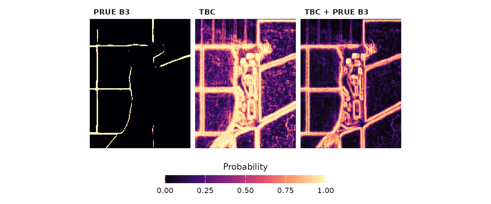
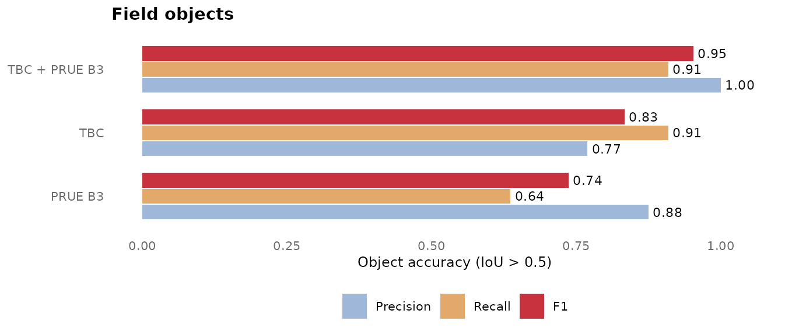

# Get started with fieldborders

A field border is often hard to see in one satellite image: two fields
of the same crop can look alike on any given day. Over a season the
border becomes obvious, because neighbouring fields are sown, irrigated,
cut and harvested at different times. The **temporal boundary contrast**
(TBC) method in `fieldborders` uses this. For pairs of pixels on either
side of a known border and pairs inside one field, it measures how
differently every band and normalised difference changes between the two
pixels over a year of monthly Sentinel-2 images, ranks the features by
how well this contrast separates the two kinds of pairs, and learns from
the best of them:

- an **edge map**, the probability that a pixel lies on a border between
  two fields, and
- a **cropland map**, the probability that a pixel belongs to a field at
  all.

Field objects are then grown from seeds inside fields by a
marker-controlled watershed on the edge map. The maps can be fused with
the output of a deep segmentation model, and the result is scored with
the object metric of the Fields of The World (FTW) benchmark.

``` r

library(fieldborders)
library(ggplot2)
library(patchwork)
```

## A Sentinel-2 time series

The package ships four small windows (about 1 km across) of monthly
Sentinel-2 scenes, ten bands each, on the FTW grid of about 5 m. This
one is in the Columbia Basin of Washington, with centre-pivot and
rectangular irrigated fields:

``` r

s <- fb_example_stack("washington")
s
#> <fb_stack> 192 x 192 pixels, 11 dates, 10 bands
#>   dates : 2024-01-14 to 2024-12-09 
#>   bands : B02, B03, B04, B05, B06, B07, B08, B8A, B11, B12 
#>   scale : 10000 
#>   crs   : WGS 84 
#>   clear : 100% 100% 100% 100% 100% 100% 100% 100% 100% 100% 100%
```

``` r

months <- c(3, 5, 7, 9)
wrap_plots(lapply(months, function(k) fb_plot_rgb(s, date = k) + labs(subtitle = NULL)), nrow = 1)
```



Your own images enter the same way through
[`fb_read_stack()`](https://ehsanrahimi666.github.io/fieldborders/reference/fb_read_stack.md)
(one multi-band file per date) or
[`fb_stack()`](https://ehsanrahimi666.github.io/fieldborders/reference/fb_stack.md)
(a `SpatRaster`), and
[`fb_s2_monthly()`](https://ehsanrahimi666.github.io/fieldborders/reference/fb_s2_monthly.md)
downloads a monthly series for any area (see
[`vignette("new-area")`](https://ehsanrahimi666.github.io/fieldborders/articles/new-area.md)).

## Edge and cropland maps

[`fb_model_pretrained()`](https://ehsanrahimi666.github.io/fieldborders/reference/fb_model_pretrained.md)
returns models fitted on reference fields in California and Washington.
[`fb_tbc_maps()`](https://ehsanrahimi666.github.io/fieldborders/reference/fb_tbc_maps.md)
applies a model to a stack:

``` r

m <- fb_model_pretrained("general")
m
#> <fb_model> temporal boundary contrast
#>   bands            : B02, B03, B04, B05, B06, B07, B08, B8A, B11, B12 
#>   edge features    : ND(B03,B08) | ND(B02,B07) | B04 | ND(B04,B11) | ND(B03,B11) | ND(B08,B11) | B08 | ND(B02,B05) 
#>   cropland learner : xgboost 
#>   training         : 75 tiles, 467,670 pairs (167,670 across), 1,470,140 pixels
#>   in-sample AUC    : edge 0.902, cropland 0.968
#>   thresholds       : t_edge 0.60, t_field 0.30, min_size 400 pixels
maps <- fb_tbc_maps(s, m)
```

``` r

fb_plot_maps(maps)
```



## From maps to fields

[`fb_delineate()`](https://ehsanrahimi666.github.io/fieldborders/reference/fb_delineate.md)
turns the maps into field objects, with the thresholds that were tuned
for the model on separate reference tiles:

``` r

m$thresholds
#> $t_edge
#> [1] 0.6
#> 
#> $t_field
#> [1] 0.3
#> 
#> $min_size
#> [1] 400
#> 
#> $min_area
#> [1] 10940
fields <- fb_delineate(maps, thresholds = m$thresholds)
```

``` r

fb_plot_fields(fields, s, date = 7)
```



[`fb_polygons()`](https://ehsanrahimi666.github.io/fieldborders/reference/fb_polygons.md)
converts the objects to an `sf` data frame with the area, perimeter,
compactness and mean map values of each field, ready to be written to
any vector format:

``` r

p <- fb_polygons(fields, maps)
head(p)
#> Simple feature collection with 6 features and 6 fields
#> Geometry type: POLYGON
#> Dimension:     XY
#> Bounding box:  xmin: -119.1713 ymin: 46.53552 xmax: -119.161 ymax: 46.54525
#> Geodetic CRS:  WGS 84
#>   field_id   area_ha perimeter_m compactness mean_edge mean_cropland
#> 1        1 23.211101   2571.4177   0.4411237 0.2024311     0.9759057
#> 2        4  1.933387    873.2404   0.3186112 0.5731383     0.8261993
#> 3        8  7.236378   1645.0143   0.3360406 0.3947174     0.9262362
#> 4       12 12.161893   1993.7818   0.3844641 0.2700907     0.9477701
#> 5       13  1.585351    863.4161   0.2672360 0.4966539     0.9203941
#> 6       14  3.386969   1124.9640   0.3363132 0.4967495     0.8474157
#>                         geometry
#> 1 POLYGON ((-119.1713 46.5452...
#> 2 POLYGON ((-119.1702 46.5384...
#> 3 POLYGON ((-119.167 46.54076...
#> 4 POLYGON ((-119.1636 46.5395...
#> 5 POLYGON ((-119.1666 46.5430...
#> 6 POLYGON ((-119.1651 46.5417...
f <- tempfile(fileext = ".gpkg")
sf::st_write(p, f, quiet = TRUE)
```

[`fb_fields()`](https://ehsanrahimi666.github.io/fieldborders/reference/fb_fields.md)
runs the same steps in one call.

## How good is it?

The California example comes with reference fields from the California
Department of Water Resources.
[`fb_reference()`](https://ehsanrahimi666.github.io/fieldborders/reference/fb_reference.md)
rasterises them to the image grid (field interior, boundary,
background), and
[`fb_evaluate()`](https://ehsanrahimi666.github.io/fieldborders/reference/fb_evaluate.md)
matches delineated and reference fields one to one at an intersection
over union above 0.5, as in the FTW benchmark:

``` r

s_ca <- fb_example_stack("california")
f_ca <- fb_example_files("california")
ref_poly <- sf::st_read(f_ca$fields, quiet = TRUE)
ref <- fb_reference(ref_poly, s_ca)
maps_ca <- fb_tbc_maps(s_ca, m)
fields_ca <- fb_delineate(maps_ca, thresholds = m$thresholds)
ev <- fb_evaluate(ref, fields_ca)
fb_accuracy(ev)[, c("reference_fields", "predicted_fields", "obj_precision", "obj_recall", "obj_f1")]
#>   reference_fields predicted_fields obj_precision obj_recall    obj_f1
#> 1               11               13     0.7692308  0.9090909 0.8333333
```

``` r

fb_plot_fields(fields_ca, s_ca, date = 7, reference = ref_poly)
```



The dashed white lines are the reference fields. A window this small
holds only a few fields, so these numbers say little about accuracy in
general;
[`vignette("validation")`](https://ehsanrahimi666.github.io/fieldborders/articles/validation.md)
summarises the validation on several thousand reference fields.

## Adding a deep model

Deep segmentation models such as the FTW PRUE models predict, for every
pixel, the probability of background, field interior and field boundary
from two images of the season.
[`fb_prue_predict()`](https://ehsanrahimi666.github.io/fieldborders/reference/fb_prue_predict.md)
runs PRUE in R (it needs the `torch` package); the examples include its
output for each window:

``` r

dl <- fb_read_probabilities(f_ca$prue)
fu <- fb_model_pretrained("general", "fusion")
fused <- fb_fuse(maps_ca, dl, fu)
```

The fusion combines the deep-model and TBC probabilities with two
logistic regressions fitted on reference pixels. The three edge maps
side by side:

``` r

edges <- c(dl[["boundary"]], maps_ca[["edge"]], fused[["edge"]])
names(edges) <- c("PRUE B3", "TBC", "TBC + PRUE B3")
fb_plot_maps(edges)
```



and the accuracy of the objects obtained from each, all with the same
object procedure (the deep model alone with the thresholds of the
fusion):

``` r

counts <- rbind(
  cbind(method = "PRUE B3", fb_evaluate(ref, fb_delineate(dl, thresholds = fu$thresholds))),
  cbind(method = "TBC", fb_evaluate(ref, fields_ca)),
  cbind(method = "TBC + PRUE B3", fb_evaluate(ref, fb_delineate(fused, thresholds = fu$thresholds))))
fb_plot_accuracy(fb_accuracy(counts, by = "method"))
```



## Where next

- [`vignette("training")`](https://ehsanrahimi666.github.io/fieldborders/articles/training.md):
  train a model on your own reference fields and choose the features and
  thresholds.
- [`vignette("new-area")`](https://ehsanrahimi666.github.io/fieldborders/articles/new-area.md):
  download Sentinel-2 for any area and map its fields.
- [`vignette("gallery")`](https://ehsanrahimi666.github.io/fieldborders/articles/gallery.md):
  the pretrained model in six farming regions around the world.
- [`vignette("validation")`](https://ehsanrahimi666.github.io/fieldborders/articles/validation.md):
  the accuracy measures and the results of the validation.
