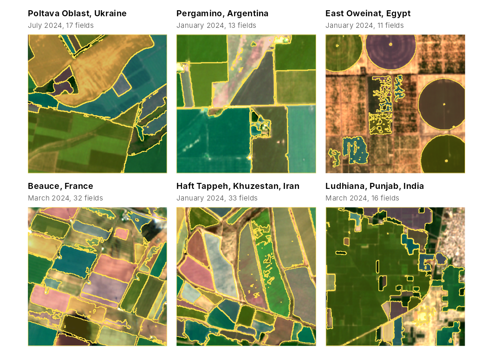

# Gallery: fields around the world

The pretrained `"general"` model was fitted in California and
Washington. These maps show what it produces, without any local
training, in six other farming regions: one season of monthly Sentinel-2
scenes downloaded with
[`fb_s2_monthly()`](https://ehsanrahimi666.github.io/fieldborders/reference/fb_s2_monthly.md)
for a box of about 1.6 by 1.6 km in each region, and the fields
delineated by
[`fb_fields()`](https://ehsanrahimi666.github.io/fieldborders/reference/fb_fields.md)
with the model’s thresholds. There are no reference fields for these
boxes, so the maps show how the method behaves, not how accurate it is;
for accuracy, see
[`vignette("validation")`](https://ehsanrahimi666.github.io/fieldborders/articles/validation.md).
Downloading needs the `rstac` package and an internet connection, so the
code is not run when the article is built. The figure was produced with
this code; the script that made it, `data-raw/vignette_gallery.R`, is in
the source repository.



``` r

library(fieldborders)
library(ggplot2)
library(patchwork)

sites <- data.frame(
  label = c("Poltava Oblast, Ukraine", "Pergamino, Argentina", "East Oweinat, Egypt", "Beauce, France",
            "Haft Tappeh, Khuzestan, Iran", "Ludhiana, Punjab, India"),
  lon = c(33.30, -60.45, 28.6584, 1.65, 48.3632, 75.65),
  lat = c(50.30, -33.85, 22.5527, 48.32, 32.0069, 30.85),
  start = c("2024-01-01", "2023-07-01", "2024-01-01", "2024-01-01", "2024-01-01", "2024-01-01"),
  end = c("2024-12-31", "2024-06-30", "2024-12-31", "2024-12-31", "2024-12-31", "2024-12-31"))

# a box of about 1.6 km around a point, in longitude and latitude
box <- function(lon, lat, half_km = 0.8) {
  dlat <- half_km / 111.32
  dlon <- half_km / (111.32 * cos(lat * pi / 180))
  c(lon - dlon, lat - dlat, lon + dlon, lat + dlat)
}
# the date with the highest median NDVI, shown as background
greenest <- function(s) {
  nb <- length(s$bands)
  v <- vapply(seq_along(s$dates), function(k) {
    x <- terra::values(s$data[[(k - 1) * nb + match(c("B08", "B04"), s$bands)]], mat = TRUE)
    median((x[, 1] - x[, 2]) / (x[, 1] + x[, 2] + 1e-4), na.rm = TRUE)
  }, 0)
  which.max(v)
}

m <- fb_model_pretrained("general")
panels <- lapply(seq_len(nrow(sites)), function(i) {
  s <- fb_s2_monthly(box(sites$lon[i], sites$lat[i]), sites$start[i], sites$end[i])
  res <- fb_fields(s, m)
  k <- greenest(s)
  fb_plot_fields(res$fields, s, date = k, fill_alpha = 0.35, title = sites$label[i]) +
    labs(subtitle = sprintf("%s, %d fields", format(s$dates[k], "%B %Y"), nrow(res$polygons)))
})
wrap_plots(panels, ncol = 3)
```

In the southern hemisphere (Pergamino) the season runs from July to
June. Each download took 1.4 to 3.0 minutes.

| Site | Dates | Date shown | Fields | Median field area (ha) |
|:---|---:|:---|---:|---:|
| Poltava Oblast, Ukraine | 9 | 17 July 2024 | 17 | 3.1 |
| Pergamino, Argentina | 12 | 26 January 2024 | 13 | 19.3 |
| East Oweinat, Egypt | 12 | 31 January 2024 | 11 | 4.4 |
| Beauce, France | 6 | 5 March 2024 | 32 | 4.3 |
| Haft Tappeh, Khuzestan, Iran | 12 | 25 January 2024 | 33 | 3.9 |
| Ludhiana, Punjab, India | 12 | 12 March 2024 | 16 | 2.5 |

Fields cut by the edge of a box are counted and measured only within it.

## What the maps show

- **Large fields with different crops** (Pergamino, Beauce, Haft Tappeh)
  come out as separate objects that follow the field borders. Some
  fields are cut into pieces or have ragged outlines where the cover
  within them varies, as in Beauce and in the middle of the Haft Tappeh
  box.
- **Centre pivots** in East Oweinat are delineated as circles. The
  rectangular plots with sparse vegetation in the middle of that box are
  broken into irregular fragments.
- **Neighbouring fields with little contrast between them** are merged:
  several of the large fields of Poltava form one object.
- **Small plots** in Ludhiana are merged into a few large objects. The
  borders between them are mostly bunds much narrower than a Sentinel-2
  pixel (10 m), which show only where the neighbouring plots differ in
  cover.

## Imperfect scenes

[`fb_s2_monthly()`](https://ehsanrahimi666.github.io/fieldborders/reference/fb_s2_monthly.md)
keeps, for each month, the scene with the fewest pixels that the
Sentinel-2 scene classification marks as missing, defective, cloud,
cloud shadow or cirrus. That classification marked every scene of these
six series as clear, but in true colour the January scene of Poltava is
covered by snow, the April scene of Poltava and the July, August and
October scenes of Ludhiana are partly cloudy or hazy, and the March
scene of Beauce holds a small cloud and its shadow. Dropping these dates
with
[`fb_subset_dates()`](https://ehsanrahimi666.github.io/fieldborders/reference/fb_subset_dates.md)
changed the delineated fields as follows:

| Site | Dates dropped | Fields with all dates | Fields without them |
|:---|:---|---:|---:|
| Poltava Oblast, Ukraine | 12 January, 16 April | 17 (of 9 dates) | 18 (of 7 dates) |
| Beauce, France | 5 March | 32 (of 6 dates) | 27 (of 5 dates) |
| Ludhiana, Punjab, India | 30 July, 24 August, 28 October | 16 (of 12 dates) | 18 (of 9 dates) |

The number of fields changed by one to five. In Beauce, which had only
six usable months, the fields became more fragmented without the March
scene. As a rule of thumb, drop a date that is largely covered by cloud,
haze or snow, and keep one in which only a small part is affected. Snow
can also be marked as invalid when downloading, with
`invalid_classes = c(0, 1, 3, 8, 9, 10, 11)`, but the scene
classification can label bright bare ground as snow.

## Data

Contains modified Copernicus Sentinel data 2023 and 2024, accessed
through the Microsoft Planetary Computer.
