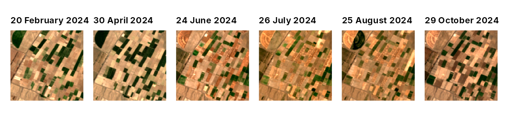
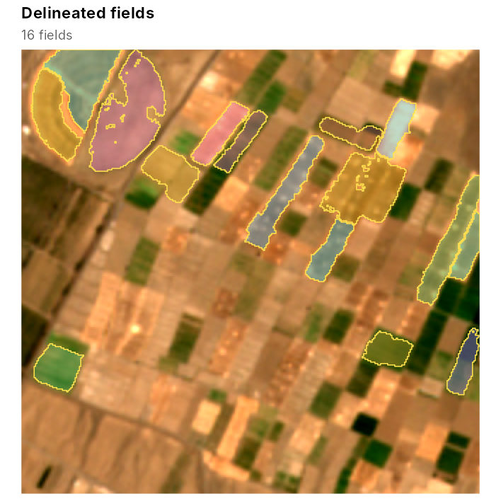
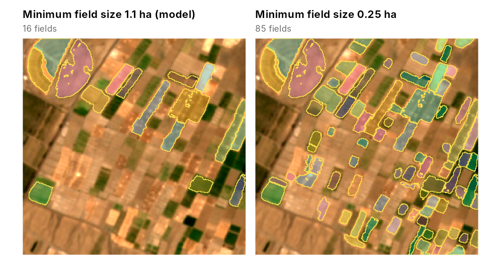
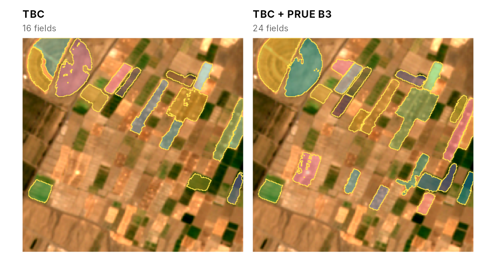

# Map a new area from Sentinel-2

This article maps the fields of an area for which the package has no
data: about 1.6 by 1.6 km near Jovein, Khorasan Razavi, Iran, with a
centre pivot and many small rectangular plots, in 2024. Downloading
needs the `rstac` package and an internet connection, and the deep model
needs `torch`, so the code is not run when the article is built. The
output and the figures below were produced with this code; the script
that made them, `data-raw/vignette_new_area.R`, is in the source
repository.

## Download a monthly time series

[`fb_s2_monthly()`](https://ehsanrahimi666.github.io/fieldborders/reference/fb_s2_monthly.md)
searches the Microsoft Planetary Computer catalogue for Sentinel-2
Level-2A scenes of the area. Among the four scenes of each month with
the least cloud cover, it keeps the one with the fewest cloudy, shadowed
or missing pixels in the area, and resamples its ten bands to one grid
in the UTM zone of the area, at 5 m by default, the pixel size of the
pretrained models:

``` r

library(fieldborders)
aoi <- c(57.436, 36.606, 57.454, 36.620)   # longitude and latitude: west, south, east, north
s <- fb_s2_monthly(aoi, "2024-01-01", "2024-12-31", dir = "jovein_s2")
#> 48 scenes found; reading scene classifications
#> 12 months kept; reading 10 bands
s
#> <fb_stack> 314 x 324 pixels, 12 dates, 10 bands
#>   dates : 2024-01-31 to 2024-12-26
#>   bands : B02, B03, B04, B05, B06, B07, B08, B8A, B11, B12
#>   scale : 10000
#>   crs   : WGS 84 / UTM zone 40N
#>   clear : 100% 100% 100% 100% 100% 100% 100% 100% 100% 100% 100% 100%
```

The download took 2.4 minutes. With `dir`, the scenes are written as
GeoTIFFs with an index table, so the series can be read again later
without downloading:

``` r

idx <- read.csv("jovein_s2/s2_index.csv")
s <- fb_read_stack(idx$image, bands = fb_example_bands(), dates = idx$date, clear = idx$clear)
```

The scene identifiers are kept with the stack, for the record of a
study:

``` r

attr(s, "items")[1:3]
#> [1] "S2A_MSIL2A_20240131T070121_R063_T40SEF_20240131T113906"
#> [2] "S2A_MSIL2A_20240220T065921_R063_T40SEF_20240220T113933"
#> [3] "S2B_MSIL2A_20240323T064629_R020_T40SEF_20240323T103903"
```

## Look at the images

``` r

library(patchwork)
wrap_plots(lapply(c(2, 4, 6, 7, 8, 10), function(k) fb_plot_rgb(s, date = k)), nrow = 1)
```



The scene classification that marks clear pixels misses some clouds,
haze and shadows, and it treats snow as clear (add class 11 to
`invalid_classes` to change this). If a date is visibly affected, drop
it before mapping, for example
`s <- fb_subset_dates(s, fb_dates(s) != as.Date("2024-02-20"))`. TBC
uses the seasonal maximum and mean of its contrasts, so it needs no
fixed number of dates, but more dates help: in the California
validation, object F1 was 0.53 with two dates, 0.56 with four and 0.57
with twelve.

## Fields from the pretrained model

``` r

res <- fb_fields(s)          # pretrained "general" model and its thresholds
res$polygons
#> Simple feature collection with 16 features and 6 fields
#> Geometry type: POLYGON
#> Dimension:     XY
#> Bounding box:  xmin: 539020 ymin: 4051600 xmax: 540605 ymax: 4052820
#> Projected CRS: WGS 84 / UTM zone 40N
#> First 5 features:
#>   field_id area_ha perimeter_m compactness mean_edge mean_cropland
#> 1        1  3.0325        1100   0.3149382 0.4988499     0.9299231
#> 2        2  1.9325         690   0.5100716 0.4472115     0.8929288
#> 3        3  3.9800        1220   0.3360263 0.4634693     0.9150371
#> 4        7  6.5050        2330   0.1505724 0.2882269     0.7485888
#> 5       15  2.2350         830   0.4076911 0.5003931     0.9149175
#>                         geometry
#> 1 POLYGON ((539055 4052750, 5...
#> 2 POLYGON ((539085 4051780, 5...
#> 3 POLYGON ((539110 4052820, 5...
#> 4 POLYGON ((539385 4052820, 5...
#> 5 POLYGON ((539470 4052480, 5...
fb_plot_fields(res$fields, s, date = 7, fill_alpha = 0.4)
```



Many plots here are smaller than the minimum field size of the
pretrained models, about 1.1 ha (`m$thresholds$min_area`, in square
metres). A smaller minimum keeps them, but it also keeps more fragments
of fields:

``` r

m <- fb_model_pretrained("general")
small <- fb_delineate(res$maps, thresholds = m$thresholds, min_area = 2500)
fb_plot_fields(res$fields, s, date = 7, fill_alpha = 0.4, title = "Minimum field size 1.1 ha (model)") +
  fb_plot_fields(small, s, date = 7, fill_alpha = 0.4, title = "Minimum field size 0.25 ha")
```



Without reference fields, choose such settings by looking at the result,
or better, map a few fields by hand and tune the thresholds on them with
[`fb_tune()`](https://ehsanrahimi666.github.io/fieldborders/reference/fb_tune.md).

## Adding the deep model

[`fb_prue_predict()`](https://ehsanrahimi666.github.io/fieldborders/reference/fb_prue_predict.md)
downloads the PRUE B3 model once (about 54 MB) and runs it on two dates
of the stack. The pretrained fusion expects the months used to fit it,
March and July; in the southern hemisphere use the same stage of the
season, for example September and January.

``` r

dl <- fb_prue_predict(s, months = c(3, 7))
res2 <- fb_fields(s, dl = dl)
fb_plot_fields(res$fields, s, date = 7, fill_alpha = 0.4, title = "TBC") +
  fb_plot_fields(res2$fields, s, date = 7, fill_alpha = 0.4, title = "TBC + PRUE B3")
```



With the deep model, 24 fields were delineated instead of 16. It added
several of the narrow plots, but it also joined plots into one object in
the centre, and many small plots are missing from both maps.

## Export

``` r

sf::st_write(res2$polygons, "jovein_fields.gpkg")
terra::writeRaster(res2$maps, "jovein_maps.tif")
```

The polygons carry their area in hectares, perimeter, compactness (4 pi
area divided by the squared perimeter) and the mean edge and cropland
probabilities inside each field.

## Tips

- The deep model works on windows of 256 by 256 pixels (about 1.3 km at
  5 m) and pads smaller areas by reflection, so map areas at least that
  large when using it; TBC works on any size.
- The pretrained models were fitted in irrigated and dryland agriculture
  of California and Washington. Where reference fields exist, train a
  local model
  ([`vignette("training")`](https://ehsanrahimi666.github.io/fieldborders/articles/training.md))
  and check it on separate tiles
  ([`vignette("validation")`](https://ehsanrahimi666.github.io/fieldborders/articles/validation.md)).
- [`fb_s2_monthly()`](https://ehsanrahimi666.github.io/fieldborders/reference/fb_s2_monthly.md)
  accepts an `sf` polygon, a bounding box or a `SpatRaster` whose grid
  is then used as is, for example to match an existing map.
