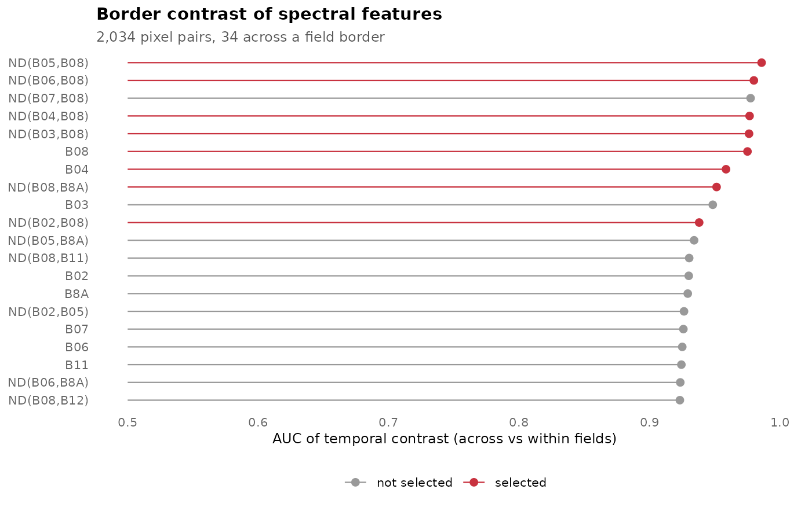
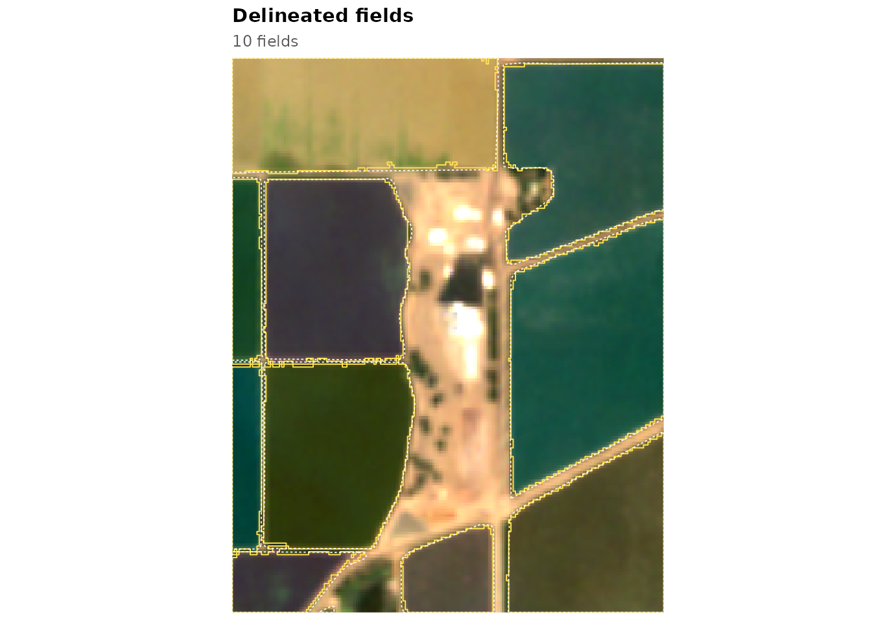

# Train a model on your own reference fields

The pretrained models were fitted on irrigated and dryland agriculture
in California and Washington. Where reference fields exist for your
region, train a model on them, alone or together with other regions, and
compare it with the pretrained models on separate tiles: in the
validation, a model fitted on California and Washington together was at
least as accurate on Washington test tiles as one fitted on Washington
alone. This article trains a model on the California example. The window
is small and the same fields are used to train and to evaluate, so the
code shows the steps, not the accuracy to expect; with real data, fit,
tune and test on different tiles, as in the validation of the package
([`vignette("validation")`](https://ehsanrahimi666.github.io/fieldborders/articles/validation.md)).

``` r

library(fieldborders)
library(ggplot2)
s <- fb_example_stack("california")
fields_poly <- sf::st_read(fb_example_files("california")$fields, quiet = TRUE)
```

## Reference raster

[`fb_reference()`](https://ehsanrahimi666.github.io/fieldborders/reference/fb_reference.md)
burns the reference polygons into the image grid: field interiors are
class 1, polygon outlines class 2 and everything else background (class
0):

``` r

ref <- fb_reference(fields_poly, s)
terra::freq(ref$class)
#>   layer value count
#> 1     1     0  7691
#> 2     1     1 27370
#> 3     1     2  1803
```

When only some fields of an area are mapped (one crop, say), pixels
outside the polygons are not known to be background. Use
`presence_only = TRUE`: they become class 3, which training ignores and
which does not count against a delineation as false positives.

## Which features show the borders?

Every candidate feature, by default the ten bands and their 45
normalised differences, is compared between the two ends of pixel pairs
that straddle a border between two fields (*across* pairs) and of pairs
inside one field (*within* pairs). For each pair the contrast
`log(|f(p) - f(q)| + 1e-4)` is computed on every date that is clear at
both ends, and its maximum and mean over the season are kept.
[`fb_rank_contrast()`](https://ehsanrahimi666.github.io/fieldborders/reference/fb_rank_contrast.md)
ranks the features by the area under the ROC curve with which the
seasonal maximum separates across from within pairs:

``` r

rk <- fb_rank_contrast(s, ref, n_pairs = 2000)
rk
#> <fb_contrast> 2034 pairs ( 34 across ), 55 features, 1 strata
#>      feature type   auc
#>  ND(B05,B08)   nd 0.986
#>  ND(B06,B08)   nd 0.980
#>  ND(B07,B08)   nd 0.978
#>  ND(B04,B08)   nd 0.977
#>  ND(B03,B08)   nd 0.976
#>          B08 band 0.975
#>          B04 band 0.959
#>  ND(B08,B8A)   nd 0.951
#>          B03 band 0.949
#>  ND(B02,B08)   nd 0.938
```

[`fb_select_features()`](https://ehsanrahimi666.github.io/fieldborders/reference/fb_select_features.md)
walks down the ranking and skips features that are strongly correlated
(Spearman’s rho above 0.9) with one already chosen:

``` r

sel <- fb_select_features(rk, k = 8)
sel
#> [1] "ND(B05,B08)" "ND(B06,B08)" "ND(B04,B08)" "ND(B03,B08)" "B08"        
#> [6] "B04"         "ND(B08,B8A)" "ND(B02,B08)"
```

``` r

fb_plot_ranking(rk, n = 20, selected = sel)
```



Here normalised differences between the red-edge and near-infrared bands
lead: they follow canopy development, which differs between neighbouring
fields through the season.

### Published spectral indices

With the `svid` package installed, the candidates can include the
published indices of its catalogue, rewritten in Sentinel-2 band names,
and expressions generated by an `svid` grammar:

``` r

fs <- fb_feature_set(fb_example_bands(), set = "svid")
table(fs$type)
#> 
#> band   nd svid 
#>   10   45  193
rk_svid <- fb_rank_contrast(s, ref, features = fs, n_pairs = 2000)
head(rk_svid$ranking[, c("feature", "type", "auc")], 10)
#>        feature type       auc
#> 1  ND(B05,B08)   nd 0.9859853
#> 2   svid:NDREI svid 0.9859853
#> 3    svid:GARI svid 0.9839853
#> 4  svid:GOSAVI svid 0.9801324
#> 5  ND(B06,B08)   nd 0.9800588
#> 6  ND(B07,B08)   nd 0.9775441
#> 7  ND(B04,B08)   nd 0.9767647
#> 8    svid:IPVI svid 0.9767353
#> 9    svid:NDVI svid 0.9767353
#> 10     svid:PI svid 0.9767353
```

## Training

[`fb_train()`](https://ehsanrahimi666.github.io/fieldborders/reference/fb_train.md)
fits the edge model, a logistic regression on the seasonal maximum and
mean contrasts of the selected features, and the cropland model,
gradient-boosted trees (or a random forest with `learner = "ranger"`, or
a logistic regression with `learner = "glm"`) on per-pixel temporal
percentiles of the bands and three indices. Passing the ranking avoids
computing the pair contrasts twice:

``` r

m <- fb_train(s, ref, contrast = rk, k = 8, n_pixels = 5000, seed = 1)
m
#> <fb_model> temporal boundary contrast
#>   bands            : B02, B03, B04, B05, B06, B07, B08, B8A, B11, B12 
#>   edge features    : ND(B05,B08) | ND(B06,B08) | ND(B04,B08) | ND(B03,B08) | B08 | B04 | ND(B08,B8A) | ND(B02,B08) 
#>   cropland learner : xgboost 
#>   training         : 1 tiles, 2,034 pairs (34 across), 10,000 pixels
#>   in-sample AUC    : edge 0.999, cropland 1.000
#>   thresholds       : t_edge 0.50, t_field 0.50, min_size 50 pixels
```

Several tiles are passed as lists. For many large tiles, the list
elements can be functions that load a tile when it is needed, so that
only one tile is in memory at a time; `strata` averages the feature
ranking over regions or field types:

``` r

# one folder of monthly images (file names with dates) and one GeoPackage of fields per tile
tiles <- c("tile_01", "tile_02", "tile_03")
images <- function(t) list.files(file.path("s2", t), pattern = "\\.tif$", full.names = TRUE)
load_stack <- function(t) function() fb_read_stack(images(t), bands = fb_example_bands())
load_ref <- function(t) function() {
  fb_reference(sf::st_read(file.path("labels", paste0(t, ".gpkg")), quiet = TRUE), terra::rast(images(t)[1]))
}
m <- fb_train(lapply(tiles, load_stack), lapply(tiles, load_ref), strata = c("irrigated", "irrigated", "dryland"))
```

## Thresholds

Three thresholds turn the maps into fields: seeds are pixels with
cropland probability above `t_field` and edge probability below
`t_edge`, and objects smaller than `min_size` pixels are dropped.
[`fb_tune()`](https://ehsanrahimi666.github.io/fieldborders/reference/fb_tune.md)
evaluates every combination on tiles with reference fields and returns
them sorted by object F1:

``` r

maps <- fb_tbc_maps(s, m)
tn <- fb_tune(maps, ref, t_edge = c(0.2, 0.3, 0.4, 0.5, 0.6), t_field = c(0.5, 0.7, 0.9),
              min_size = c(0, 50, 100, 200))
head(tn)
#>   t_edge t_field min_size tp fp fn precision    recall       f1
#> 1    0.2     0.5       50 10  0  1         1 0.9090909 0.952381
#> 2    0.2     0.5      100 10  0  1         1 0.9090909 0.952381
#> 3    0.2     0.5      200 10  0  1         1 0.9090909 0.952381
#> 4    0.3     0.5       50 10  0  1         1 0.9090909 0.952381
#> 5    0.3     0.5      100 10  0  1         1 0.9090909 0.952381
#> 6    0.3     0.5      200 10  0  1         1 0.9090909 0.952381
m$thresholds <- as.list(tn[1, c("t_edge", "t_field", "min_size")])
```

Choose the thresholds on tiles that are not used to fit the model, and
report accuracy on a third set of tiles.

``` r

fb_plot_fields(fb_delineate(maps, thresholds = m$thresholds), s, date = 7, reference = fields_poly)
```



## Saving the model

``` r

f <- tempfile(fileext = ".rds")
fb_save_model(m, f)
m2 <- fb_load_model(f)
identical(m2$edge, m$edge)
#> [1] TRUE
```

## A fusion for your region

With deep-model probabilities on the training tiles,
[`fb_fit_fusion()`](https://ehsanrahimi666.github.io/fieldborders/reference/fb_fit_fusion.md)
fits the combination of the two models on the same reference rasters:

``` r

dl <- fb_read_probabilities(fb_example_files("california")$prue)
fu <- fb_fit_fusion(maps, dl, ref, seed = 1)
fu
#> <fb_fusion> logistic fusion of deep-model and TBC maps
#>   boundary: 0.020 + 0.114 logit P(boundary) + 0.207 logit(edge)
#>   field   : 2.606 + 0.090 logit P(field + boundary) + 0.782 logit(cropland)
#>   thresholds: t_edge 0.40, t_field 0.50, min_size 50 pixels
```
