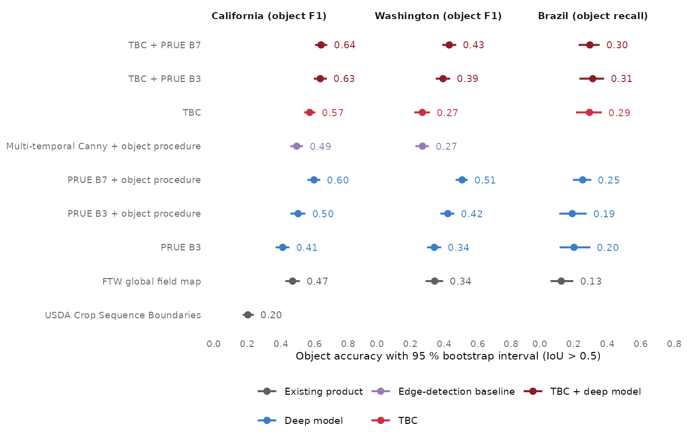

# How accurate is it?

``` r

library(fieldborders)
library(ggplot2)
```

## The object metric

Field boundaries are judged by whether each field comes out as one
object.
[`fb_evaluate()`](https://ehsanrahimi666.github.io/fieldborders/reference/fb_evaluate.md)
uses the object metric of the Fields of The World (FTW) benchmark:

- reference fields are the 4-connected shapes of the field-interior
  class of the reference raster, and delineated fields the objects of
  [`fb_delineate()`](https://ehsanrahimi666.github.io/fieldborders/reference/fb_delineate.md);
- a delineated and a reference field match when their intersection over
  union (IoU) exceeds 0.5. Above 0.5 a field can match at most one
  other, so the matching is one to one without any assignment step;
- object precision is the share of delineated fields that match, object
  recall the share of reference fields that are matched, and F1 their
  harmonic mean. Delineated fields that lie mostly (more than half) in
  unlabelled reference pixels are not counted as false positives, so
  that partial reference maps can be used.

[`fb_evaluate()`](https://ehsanrahimi666.github.io/fieldborders/reference/fb_evaluate.md)
returns counts, which add up over tiles;
[`fb_accuracy()`](https://ehsanrahimi666.github.io/fieldborders/reference/fb_accuracy.md)
turns them into rates, including the recall of reference fields by size
class:

``` r

s <- fb_example_stack("california")
f <- fb_example_files("california")
ref <- fb_reference(sf::st_read(f$fields, quiet = TRUE), s)
m <- fb_model_pretrained("general")
fields <- fb_delineate(fb_tbc_maps(s, m), thresholds = m$thresholds)
ev <- fb_evaluate(ref, fields)
ev[, c("tp", "fp", "fn", "obj_tp", "obj_fp", "obj_fn", "n_pred")]
#>      tp   fp  fn obj_tp obj_fp obj_fn n_pred
#> 1 26376 2722 994     10      3      1     13
fb_accuracy(ev)[, c("reference_fields", "predicted_fields", "obj_precision", "obj_recall", "obj_f1")]
#>   reference_fields predicted_fields obj_precision obj_recall    obj_f1
#> 1               11               13     0.7692308  0.9090909 0.8333333
```

Summing counts over tiles before computing the rates, as
[`fb_accuracy()`](https://ehsanrahimi666.github.io/fieldborders/reference/fb_accuracy.md)
does, weights every field equally, whatever the tile it lies in.

## Uncertainty and comparisons

Fields in one tile share imagery, crops and management, so tiles, not
fields, are the units to resample.
[`fb_bootstrap()`](https://ehsanrahimi666.github.io/fieldborders/reference/fb_bootstrap.md)
draws tiles with replacement (within strata, if given) and uses the same
draws for the two methods of a comparison. To show the interface, the
California example is cut into four quarters, standing in for tiles:

``` r

quarters <- function(r) {
  e <- as.vector(terra::ext(r)); xm <- mean(e[1:2]); ym <- mean(e[3:4])
  list(terra::ext(e[1], xm, ym, e[4]), terra::ext(xm, e[2], ym, e[4]),
       terra::ext(e[1], xm, e[3], ym), terra::ext(xm, e[2], e[3], ym))
}
dl <- fb_read_probabilities(f$prue)
fu <- fb_model_pretrained("general", "fusion")
methods <- list(TBC = fields,
                `TBC + PRUE B3` = fb_delineate(fb_fuse(fb_tbc_maps(s, m), dl, fu), thresholds = fu$thresholds))
counts <- do.call(rbind, lapply(seq_along(quarters(ref)), function(k) {
  e <- quarters(ref)[[k]]
  do.call(rbind, lapply(names(methods), function(nm)
    cbind(tile = k, method = nm, fb_evaluate(terra::crop(ref, e), terra::crop(methods[[nm]], e)))))
}))
fb_accuracy(counts, by = "method")[, c("method", "obj_precision", "obj_recall", "obj_f1")]
#>          method obj_precision obj_recall    obj_f1
#> 1           TBC     0.7142857     0.9375 0.8108108
#> 2 TBC + PRUE B3     1.0000000     0.9375 0.9677419
fb_bootstrap(counts, c("TBC + PRUE B3", "TBC"), B = 1000)
#>            comparison metric difference         lo   hi
#> 1 TBC + PRUE B3 - TBC obj_f1  0.1569311 0.07692308 0.25
```

With four tiles the interval is meaningless; the validation below used
44 to 54 test tiles per region.

## The validation study

The method was developed in California and validated in three regions on
tiles of 512 x 512 pixels (3.1 km north to south and 2.1 to 3.1 km east
to west). In each region the tiles were assigned to fitting, tuning and
test sets in blocks of 0.2 degrees, so that neighbouring tiles fell into
the same set. Models were fitted on the fitting tiles, the input months
of the deep model and all thresholds were chosen on the tuning tiles,
and the test tiles were evaluated once:

- **California 2024**: reference fields from the California Department
  of Water Resources Statewide Crop Mapping 2024; 120 tiles in four
  farming regions (44 fitting, 22 tuning and 54 test tiles, with 3,696
  reference fields).
- **Washington**: reference fields from the Washington State Department
  of Agriculture agricultural land use map, with imagery of 2024 or
  2025, the year in which most fields of a tile were surveyed; 90 tiles
  in the irrigated Columbia Basin, the dryland farming of the Palouse
  and the Yakima Valley (31 fitting, 15 tuning and 44 test tiles, with
  2,155 reference fields). Models were fitted and tuned on Washington
  tiles.
- **Brazil 2019/20**: reference fields from the crop maps of the
  Brazilian National Supply Company (CONAB) for summer crops in
  Tocantins and irrigated rice in Rio Grande do Sul; 60 tiles (13 tuning
  and 47 test tiles, with 594 reference fields). These maps outline only
  the mapped crop, so most fields in a tile are unlabelled and object
  precision says little; object recall is the measure that counts. The
  models were fitted and tuned on California and Washington tiles,
  without any Brazilian labels.

The deep models are the FTW PRUE models with EfficientNet-B3 (trained on
CC-BY data) and EfficientNet-B7 encoders, applied to two monthly scenes:
March and July in California, May and August in Washington (chosen on
the tuning tiles) and September and January in Brazil. “Object
procedure” means that their probabilities were turned into fields with
the same seeds, watershed and size filter as TBC. The FTW global field
map and, in California, the USDA Crop Sequence Boundaries were evaluated
on the same tiles without any fitting.

``` r

acc <- read.csv(system.file("extdata", "validation", "object_accuracy.csv", package = "fieldborders"))
va <- acc[acc$analysis == "primary", ]
f1 <- va$primary_metric == "obj_f1"
va$value <- ifelse(f1, va$obj_f1, va$obj_recall)
va$lo <- ifelse(f1, va$f1_lo, va$recall_lo)
va$hi <- ifelse(f1, va$f1_hi, va$recall_hi)
va$panel <- factor(paste(va$region, ifelse(f1, "(object F1)", "(object recall)")),
                   levels = c("California (object F1)", "Washington (object F1)", "Brazil (object recall)"))
va$method <- factor(va$method, levels = c("USDA Crop Sequence Boundaries", "FTW global field map", "PRUE B3",
                                          "PRUE B3 + object procedure", "PRUE B7 + object procedure",
                                          "Multi-temporal Canny + object procedure", "TBC", "TBC + PRUE B3",
                                          "TBC + PRUE B7"))
cols <- c(`Existing product` = "#5F5F5F", `Deep model` = "#3A7DC9", `Edge-detection baseline` = "#9A7BB5",
          TBC = "#C8323F", `TBC + deep model` = "#8E1B26")
ggplot(va, aes(value, method, colour = family)) +
  geom_errorbar(aes(xmin = lo, xmax = hi), width = 0, linewidth = 0.7, orientation = "y") +
  geom_point(size = 2) +
  geom_text(aes(x = hi, label = sprintf("%.2f", value)), hjust = -0.3, size = 2.6, show.legend = FALSE) +
  facet_wrap(~panel) +
  scale_colour_manual(values = cols, breaks = names(cols), name = NULL) +
  scale_x_continuous(limits = c(0, 0.85), breaks = seq(0, 0.8, 0.2)) +
  labs(x = "Object accuracy with 95 % bootstrap interval (IoU > 0.5)", y = NULL) +
  fb_theme(base_size = 9) +
  theme(legend.position = "bottom", axis.title.x = element_text(size = 8)) +
  guides(colour = guide_legend(nrow = 2))
```



The results differ between the regions:

- In **California**, TBC without any deep model reached an object F1 of
  0.57, above the CC-BY PRUE model with or without the object procedure
  (0.50 and 0.41), the FTW global map (0.47) and the multi-temporal
  Canny edges given the same cropland map and object procedure (0.49);
  it did not differ clearly from PRUE B7 with the object procedure
  (0.60). Fusing TBC with PRUE B3 or B7 gave the highest F1 (0.63 and
  0.64).
- In **Washington**, TBC split many fields into fragments (object
  precision 0.20), most of all in the dryland farming of the Palouse.
  Its F1 of 0.27 was below that of PRUE B3 and B7 with the object
  procedure (0.42 and 0.51) and of the FTW global map (0.34), and level
  with the Canny edges. The F1 of the fusion (0.39 with B3) was higher
  than that of TBC alone and of the FTW global map, but not higher than
  that of the deep models with the object procedure.
- In **Brazil**, with models from California and Washington, TBC and its
  fusion with B3 recovered more reference fields (object recall 0.29 and
  0.31) than PRUE B3 with the object procedure (0.19) and the FTW global
  map (0.13). The gain came from the irrigated rice of Rio Grande do
  Sul; for the summer crops of Tocantins, recall was similar or lower.
  All methods recovered fewer than a third of the reference fields.

In Washington, the tuning chose the largest minimum field size of the
pre-specified grid (50 pixels, about 0.14 ha) for TBC. In a secondary
analysis, added after these results were seen, the thresholds of TBC,
PRUE with the object procedure and their fusion were tuned again on the
Washington tuning tiles over the wider grid used for the pretrained
models (minimum field sizes up to 400 pixels), and the test tiles were
evaluated again:

``` r

ex <- acc[acc$analysis != "primary", ]
ex$`F1 (95 % CI)` <- sprintf("%.2f (%.2f to %.2f)", ex$obj_f1, ex$f1_lo, ex$f1_hi)
ex$Precision <- round(ex$obj_precision, 2)
ex$Recall <- round(ex$obj_recall, 2)
knitr::kable(ex[, c("method", "Precision", "Recall", "F1 (95 % CI)")], row.names = FALSE,
             col.names = c("Method (Washington, wider grid)", "Precision", "Recall", "F1 (95 % CI)"))
```

| Method (Washington, wider grid) | Precision | Recall | F1 (95 % CI)        |
|:--------------------------------|----------:|-------:|:--------------------|
| PRUE B3 + object procedure      |      0.64 |   0.33 | 0.44 (0.40 to 0.48) |
| PRUE B7 + object procedure      |      0.71 |   0.41 | 0.52 (0.48 to 0.55) |
| TBC                             |      0.62 |   0.37 | 0.47 (0.43 to 0.50) |
| TBC + PRUE B3                   |      0.70 |   0.38 | 0.49 (0.45 to 0.53) |
| TBC + PRUE B7                   |      0.70 |   0.40 | 0.51 (0.47 to 0.55) |

With the wider grid, TBC split far fewer fields: its F1 rose to 0.47,
level with PRUE B3 with the object procedure (0.44), and the fusion with
B3 reached 0.49. PRUE B7 with the object procedure (0.52) remained more
accurate than TBC, and its fusion with TBC (0.51) did not improve on it.
Much of the gap in the pre-specified comparison therefore came from the
thresholds, chiefly the minimum field size: on the tuning tiles, a
larger minimum raised the F1 of TBC markedly but hardly changed that of
the deep model. Because this analysis was chosen after the results were
known, it does not replace the pre-specified comparison.

TBC is therefore a strong method where it was developed and a useful
complement to the deep models, but it is not uniformly better than they
are, and its accuracy depends on the minimum field size. Where reference
fields of the target region exist, train a local model
([`vignette("training")`](https://ehsanrahimi666.github.io/fieldborders/articles/training.md)),
tune its thresholds over a wide grid and compare TBC, the deep model and
their fusion on separate tiles before mapping a large area.

## The pretrained models

The pretrained models of the package were fitted with
[`fb_train()`](https://ehsanrahimi666.github.io/fieldborders/reference/fb_train.md)
and
[`fb_fit_fusion()`](https://ehsanrahimi666.github.io/fieldborders/reference/fb_fit_fusion.md)
on the fitting tiles of California and of California and Washington
together, and their thresholds were tuned with
[`fb_tune()`](https://ehsanrahimi666.github.io/fieldborders/reference/fb_tune.md)
on the tuning tiles, over a wider grid than in the validation above
(minimum field sizes up to 400 pixels instead of 50). On the test tiles,
which were not used to fit or tune them:

``` r

pm <- read.csv(system.file("extdata", "validation", "pretrained_models.csv", package = "fieldborders"))
tab <- data.frame(Model = pm$model, `Test tiles` = sprintf("%s (%d)", pm$region, pm$tiles), Method = pm$method,
                  Fields = pm$reference_fields, Precision = round(pm$obj_precision, 2),
                  Recall = round(pm$obj_recall, 2),
                  `F1 [95 % CI]` = sprintf("%.2f [%.2f, %.2f]", pm$obj_f1, pm$f1_lo, pm$f1_hi),
                  `Recall < 1 ha` = round(pm$recall_s1, 3), check.names = FALSE)
knitr::kable(tab)
```

| Model | Test tiles | Method | Fields | Precision | Recall | F1 \[95 % CI\] | Recall \< 1 ha |
|:---|:---|:---|---:|---:|---:|:---|---:|
| california | California (54) | TBC | 3696 | 0.78 | 0.53 | 0.63 \[0.59, 0.67\] | 0.003 |
| california | California (54) | TBC + PRUE B3 | 3696 | 0.82 | 0.55 | 0.66 \[0.62, 0.70\] | 0.006 |
| general | California (54) | TBC | 3696 | 0.76 | 0.54 | 0.63 \[0.59, 0.67\] | 0.010 |
| general | California (54) | TBC + PRUE B3 | 3696 | 0.80 | 0.54 | 0.64 \[0.60, 0.68\] | 0.007 |
| general | Washington (44) | TBC | 2155 | 0.54 | 0.40 | 0.46 \[0.41, 0.50\] | 0.011 |
| general | Washington (44) | TBC + PRUE B3 | 2155 | 0.65 | 0.42 | 0.51 \[0.48, 0.55\] | 0.014 |

With a minimum field size of about 1.1 ha, the pretrained models find
almost none of the reference fields smaller than 1 ha, but they split
few fields. In Washington, the `"general"` model reached an F1 of 0.457
alone and 0.513 fused with PRUE B3, close to the models fitted and tuned
on Washington alone over the same grid (secondary analysis above). The R
implementation reproduces the pipeline used for the validation: with the
same design, the validation pipeline reached an F1 of 0.633 with TBC and
0.659 with the fusion on the California test tiles, against 0.632 and
0.659 for the `"california"` models of the package.
