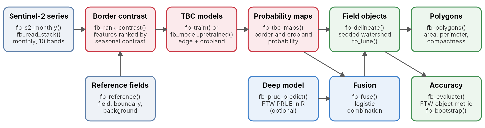

# fieldborders

**Agricultural field boundaries from Sentinel-2 time series**

**Documentation site:** <https://ehsanrahimi666.github.io/fieldborders/>

Where one field ends and the next begins is often invisible in a single
satellite image, but it shows over a season: neighbouring fields are
sown, irrigated, cut and harvested at different times. `fieldborders`
learns which spectral bands and indices change most differently across
field borders through a year of monthly Sentinel-2 images (**temporal
boundary contrast**, TBC), turns the selected contrasts into an edge map
and a cropland map, and grows field objects from seeds inside fields by
a marker-controlled watershed. It needs no deep network and no GPU,
ships pretrained models, and can run and fuse the Fields of The World
(FTW) PRUE deep models in R. Results come as rasters and polygons,
scored with the object metric of the FTW benchmark.


From a year of Sentinel-2 images to fields: Columbia Basin, Washington

## Installation

`fieldborders` needs R (\>= 4.1) with `terra` and `sf`. It contains C++
code, so installing from source needs a compiler: Rtools on Windows, the
Xcode command line tools on macOS.

``` r

install.packages("remotes")
remotes::install_github("ehsanrahimi666/fieldborders")
```

Optional packages: `rstac` to download Sentinel-2
([`fb_s2_monthly()`](https://ehsanrahimi666.github.io/fieldborders/reference/fb_s2_monthly.md)),
`torch` to run the PRUE deep model
([`fb_prue_predict()`](https://ehsanrahimi666.github.io/fieldborders/reference/fb_prue_predict.md);
after installing it, run
[`torch::install_torch()`](https://torch.mlverse.org/docs/reference/install_torch.html)
once), `svid` for published spectral indices as candidate features
(`remotes::install_github("ehsanrahimi666/_SVID")`), and `patchwork` for
the multi-panel figures of the articles.

## Quick start (runs as-is, no files needed)

``` r

library(fieldborders)

s <- fb_example_stack("washington")   # 11 monthly Sentinel-2 scenes, 10 bands, about 5 m
res <- fb_fields(s)                   # pretrained model: maps, field objects, polygons
res$polygons
#> Simple feature collection with 8 features and 6 fields
#> Geometry type: POLYGON
#> Dimension:     XY
#> Bounding box:  xmin: -119.1713 ymin: 46.53487 xmax: -119.161 ymax: 46.54525
#> Geodetic CRS:  WGS 84
#>   field_id   area_ha perimeter_m compactness mean_edge mean_cropland                       geometry
#> 1        1 23.211101   2571.4177   0.4411237 0.2024311     0.9759057 POLYGON ((-119.1713 46.5452...
#> 2        4  1.933387    873.2404   0.3186112 0.5731383     0.8261993 POLYGON ((-119.1702 46.5384...
#> 3        8  7.236378   1645.0143   0.3360406 0.3947174     0.9262362 POLYGON ((-119.167 46.54076...
#> 4       12 12.161893   1993.7818   0.3844641 0.2700907     0.9477701 POLYGON ((-119.1636 46.5395...
#> 5       13  1.585351    863.4161   0.2672360 0.4966539     0.9203941 POLYGON ((-119.1666 46.5430...
#> 6       14  3.386969   1124.9640   0.3363132 0.4967495     0.8474157 POLYGON ((-119.1651 46.5417...
#> 7       15  5.852475   1330.9757   0.4151539 0.1974421     0.9655053 POLYGON ((-119.161 46.53785...
#> 8       16 14.884227   2000.3186   0.4674528 0.2428621     0.9734632 POLYGON ((-119.1623 46.5452...
```

``` r

fb_plot_fields(res$fields, s, date = 7)
```


## How it works



The workflow and its functions

1.  **Border contrast.** For pixel pairs that straddle the border
    between two reference fields and pairs inside one field, every band
    and normalised difference is compared between the two ends of the
    pair on each clear date. The seasonal maximum and mean of the log
    absolute difference rank the features by how well they separate the
    two kinds of pairs
    ([`fb_rank_contrast()`](https://ehsanrahimi666.github.io/fieldborders/reference/fb_rank_contrast.md)),
    and a set of weakly correlated top features is kept
    ([`fb_select_features()`](https://ehsanrahimi666.github.io/fieldborders/reference/fb_select_features.md)).
2.  **Models.** A logistic regression on the contrasts of the selected
    features gives the probability that a pixel lies on a border;
    gradient-boosted trees on per-pixel temporal percentiles give the
    probability that it is cropland
    ([`fb_train()`](https://ehsanrahimi666.github.io/fieldborders/reference/fb_train.md)).
    Pretrained models are included
    ([`fb_model_pretrained()`](https://ehsanrahimi666.github.io/fieldborders/reference/fb_model_pretrained.md)).
3.  **Fields.** Seeds are pixels that are likely cropland and unlikely
    border; a marker-controlled watershed on the edge map assigns the
    remaining cropland pixels to them, and objects below a minimum size
    are dropped
    ([`fb_delineate()`](https://ehsanrahimi666.github.io/fieldborders/reference/fb_delineate.md)),
    with thresholds tuned on reference fields
    ([`fb_tune()`](https://ehsanrahimi666.github.io/fieldborders/reference/fb_tune.md)).
4.  **Deep models (optional).** The FTW PRUE model runs in R
    ([`fb_prue_predict()`](https://ehsanrahimi666.github.io/fieldborders/reference/fb_prue_predict.md)),
    and a logistic fusion combines its probabilities with the TBC maps
    ([`fb_fuse()`](https://ehsanrahimi666.github.io/fieldborders/reference/fb_fuse.md)).

## Example 1: four landscapes

The package ships about 1 km windows of four agricultural landscapes,
none of them used to fit or tune the pretrained models.

``` r

for (nm in fb_example_names()) {
  s <- fb_example_stack(nm)
  dl <- fb_read_probabilities(fb_example_files(nm)$prue)   # PRUE B3 output for the window
  res <- fb_fields(s, dl = dl)                             # TBC fused with PRUE B3
  print(fb_plot_fields(res$fields, s, date = 7))
}
```


Delineated fields in four landscapes

## Example 2: accuracy against reference fields

The California window comes with reference fields of the California
Department of Water Resources (CC0).
[`fb_evaluate()`](https://ehsanrahimi666.github.io/fieldborders/reference/fb_evaluate.md)
applies the FTW object metric: a delineated and a reference field match
when their intersection over union exceeds 0.5.

``` r

s <- fb_example_stack("california")
f <- fb_example_files("california")
ref <- fb_reference(sf::st_read(f$fields, quiet = TRUE), s)

m <- fb_model_pretrained("general")
fields <- fb_delineate(fb_tbc_maps(s, m), thresholds = m$thresholds)
fb_accuracy(fb_evaluate(ref, fields))[, c("reference_fields", "predicted_fields", "obj_precision",
                                          "obj_recall", "obj_f1")]
#>   reference_fields predicted_fields obj_precision obj_recall    obj_f1
#> 1               11               13     0.7692308  0.9090909 0.8333333
```

## Example 3: fusion with a deep model

``` r

dl <- fb_read_probabilities(f$prue)                       # or fb_prue_predict(s, months = c(3, 7))
fused <- fb_fuse(fb_tbc_maps(s, m), dl, fb_model_pretrained("general", "fusion"))
fb_plot_maps(fused)
```


Edge maps of PRUE B3, TBC and their fusion, and the accuracy of the
fields obtained from each

## Example 4: which features show the borders?

``` r

rk <- fb_rank_contrast(s, ref, n_pairs = 4000)
fb_plot_ranking(rk, n = 20, selected = fb_select_features(rk, k = 8))
```


## Example 5: your own area

``` r

aoi <- c(57.436, 36.606, 57.454, 36.620)        # lon/lat box near Jovein, Khorasan Razavi, Iran
s <- fb_s2_monthly(aoi, "2024-01-01", "2024-12-31", dir = "jovein_s2")
res <- fb_fields(s)
sf::st_write(res$polygons, "jovein_fields.gpkg")
```

[`fb_s2_monthly()`](https://ehsanrahimi666.github.io/fieldborders/reference/fb_s2_monthly.md)
searches Microsoft Planetary Computer for Sentinel-2 Level-2A scenes,
keeps the clearest scene of each month and resamples it to a common
grid. See
[`vignette("new-area")`](https://ehsanrahimi666.github.io/fieldborders/articles/new-area.md)
for the full example, with the deep model.

## Example 6: fields around the world

The pretrained model, applied without local training to one season of
monthly scenes of about 1.6 km boxes in six farming regions (code in
[`vignette("gallery")`](https://ehsanrahimi666.github.io/fieldborders/articles/gallery.md)):


Fields delineated by the pretrained model in six farming regions

Large fields with different crops, and centre pivots, come out as
separate objects; neighbouring fields with little contrast, and small
plots such as those of Ludhiana, are merged.

## Example 7: train on your own fields

``` r

ref <- fb_reference(my_fields, s)               # sf polygons, one feature per field
m <- fb_train(s, ref)                           # lists of stacks and references for many tiles
tn <- fb_tune(fb_tbc_maps(s_tune, m), ref_tune) # thresholds on separate tiles
m$thresholds <- as.list(tn[1, c("t_edge", "t_field", "min_size")])
fb_save_model(m, "my_model.rds")
```

## Validation

The method was validated on held-out test tiles in three regions, with
the object metric of the FTW benchmark (details in
[`vignette("validation")`](https://ehsanrahimi666.github.io/fieldborders/articles/validation.md)):

- **California 2024** (54 test tiles, 3,696 reference fields): TBC
  without a deep model reached an object F1 of 0.57, against 0.50 for
  the CC-BY PRUE model with the same object procedure and 0.47 for the
  FTW global field map 2024; TBC fused with PRUE B3 reached 0.63.
- **Washington** (44 test tiles, 2,155 reference fields): TBC split many
  fields into fragments and reached 0.27, below PRUE B3 with the object
  procedure (0.42) and the FTW map (0.34); fused with PRUE B3 it reached
  0.39.
- **Brazil 2019/20** (47 test tiles, partial reference maps, so object
  recall is the measure), with models fitted in California and
  Washington: TBC recovered 0.29 of the reference fields and its fusion
  with PRUE B3 0.31, against 0.19 for PRUE B3 with the object procedure
  and 0.13 for the FTW map; the gain came from irrigated rice.

TBC is therefore not uniformly better than a deep model. Where reference
fields exist, compare TBC, the deep model and their fusion on your own
tiles before mapping a large area. The pretrained `"general"` model,
whose minimum field size of about 1.1 ha was tuned over a wider grid,
reached an object F1 of 0.63 alone and 0.64 fused with PRUE B3 on the
California test tiles, and 0.46 and 0.51 on the Washington test tiles;
it misses almost all fields smaller than 1 ha.


Object accuracy of field delineation methods on the test tiles of three
regions

## Main functions

| Function | Purpose |
|----|----|
| [`fb_s2_monthly()`](https://ehsanrahimi666.github.io/fieldborders/reference/fb_s2_monthly.md) | monthly Sentinel-2 time series for any area (STAC) |
| [`fb_stack()`](https://ehsanrahimi666.github.io/fieldborders/reference/fb_stack.md), [`fb_read_stack()`](https://ehsanrahimi666.github.io/fieldborders/reference/fb_read_stack.md), [`fb_write_stack()`](https://ehsanrahimi666.github.io/fieldborders/reference/fb_write_stack.md) | image time series from rasters or files |
| [`fb_reference()`](https://ehsanrahimi666.github.io/fieldborders/reference/fb_reference.md) | reference raster (field, boundary, background) from polygons |
| [`fb_rank_contrast()`](https://ehsanrahimi666.github.io/fieldborders/reference/fb_rank_contrast.md), [`fb_select_features()`](https://ehsanrahimi666.github.io/fieldborders/reference/fb_select_features.md) | rank and select features by border contrast |
| [`fb_feature_set()`](https://ehsanrahimi666.github.io/fieldborders/reference/fb_feature_set.md) | candidate features: bands, normalised differences, `svid` indices |
| [`fb_train()`](https://ehsanrahimi666.github.io/fieldborders/reference/fb_train.md), [`fb_model_pretrained()`](https://ehsanrahimi666.github.io/fieldborders/reference/fb_model_pretrained.md) | TBC models: train your own or use the pretrained ones |
| [`fb_tbc_maps()`](https://ehsanrahimi666.github.io/fieldborders/reference/fb_tbc_maps.md) | edge and cropland probability maps |
| [`fb_prue_predict()`](https://ehsanrahimi666.github.io/fieldborders/reference/fb_prue_predict.md), [`fb_read_probabilities()`](https://ehsanrahimi666.github.io/fieldborders/reference/fb_read_probabilities.md) | FTW PRUE deep model in R, or its saved output |
| [`fb_fit_fusion()`](https://ehsanrahimi666.github.io/fieldborders/reference/fb_fit_fusion.md), [`fb_fuse()`](https://ehsanrahimi666.github.io/fieldborders/reference/fb_fuse.md) | combine TBC and deep-model probabilities |
| [`fb_delineate()`](https://ehsanrahimi666.github.io/fieldborders/reference/fb_delineate.md), [`fb_tune()`](https://ehsanrahimi666.github.io/fieldborders/reference/fb_tune.md) | field objects and their thresholds |
| [`fb_fields()`](https://ehsanrahimi666.github.io/fieldborders/reference/fb_fields.md) | maps, fields and polygons in one call |
| [`fb_polygons()`](https://ehsanrahimi666.github.io/fieldborders/reference/fb_polygons.md) | field polygons with area, perimeter and compactness |
| [`fb_evaluate()`](https://ehsanrahimi666.github.io/fieldborders/reference/fb_evaluate.md), [`fb_accuracy()`](https://ehsanrahimi666.github.io/fieldborders/reference/fb_accuracy.md), [`fb_bootstrap()`](https://ehsanrahimi666.github.io/fieldborders/reference/fb_bootstrap.md) | FTW object metric, rates and paired bootstrap |
| [`fb_plot_rgb()`](https://ehsanrahimi666.github.io/fieldborders/reference/fb_plot_rgb.md), [`fb_plot_maps()`](https://ehsanrahimi666.github.io/fieldborders/reference/fb_plot_maps.md), [`fb_plot_fields()`](https://ehsanrahimi666.github.io/fieldborders/reference/fb_plot_fields.md), [`fb_plot_ranking()`](https://ehsanrahimi666.github.io/fieldborders/reference/fb_plot_ranking.md), [`fb_plot_accuracy()`](https://ehsanrahimi666.github.io/fieldborders/reference/fb_plot_accuracy.md) | maps and graphs |

## Bundled data

`inst/extdata/<name>`, read with
[`fb_example_stack()`](https://ehsanrahimi666.github.io/fieldborders/reference/fb_example_files.md)
and
[`fb_example_files()`](https://ehsanrahimi666.github.io/fieldborders/reference/fb_example_files.md):

| Name | Area | Season | Reference fields |
|----|----|----|----|
| `california` | Colusa County, Sacramento Valley, USA | 2024 | 10 polygons (DWR Statewide Crop Mapping 2024, CC0) |
| `washington` | Columbia Basin, Washington, USA | 2024 | none |
| `brazil` | Tocantins, Brazil | July 2019 to June 2020 | none |
| `moghan` | Moghan plain, Ardabil, Iran | 2024 | none |

Each holds monthly Sentinel-2 scenes (ten bands) with clear-sky masks,
the PRUE B3 output for the window and, except for Brazil, the FTW global
field map of the same year (CC-BY-4.0). Contains modified Copernicus
Sentinel data 2019, 2020 and 2024.

## Getting help

- Help for a function:
  [`?fb_delineate`](https://ehsanrahimi666.github.io/fieldborders/reference/fb_delineate.md)
- Articles:
  [`vignette("fieldborders")`](https://ehsanrahimi666.github.io/fieldborders/articles/fieldborders.md),
  [`vignette("training")`](https://ehsanrahimi666.github.io/fieldborders/articles/training.md),
  [`vignette("new-area")`](https://ehsanrahimi666.github.io/fieldborders/articles/new-area.md),
  [`vignette("gallery")`](https://ehsanrahimi666.github.io/fieldborders/articles/gallery.md),
  [`vignette("validation")`](https://ehsanrahimi666.github.io/fieldborders/articles/validation.md),
  also on the documentation site
- Reference manual: `manual/fieldborders-manual.pdf`
- Questions and bug reports:
  <https://github.com/ehsanrahimi666/fieldborders/issues>

## Citation

Rahimi, E. & Jung, C. (2026) fieldborders: agricultural field boundaries
from Sentinel-2 time series. R package version 1.0.0.
<https://github.com/ehsanrahimi666/fieldborders>

The PRUE models are those of the Fields of The World project (Kerner et
al., 2025, <https://doi.org/10.1609/aaai.v39i27.35034>).

## Licence

GPL-3. The example data keep their own terms (see
[`?fb_example_files`](https://ehsanrahimi666.github.io/fieldborders/reference/fb_example_files.md)).
